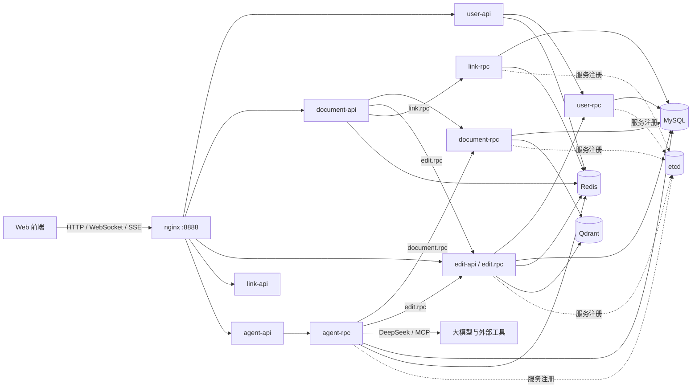

# Muti-Document

Muti-Document（MutiDoc）是一个支持多人实时协作的在线文档平台后端。项目采用
go-zero 微服务架构，包含用户、文档、协同编辑、链接分享和 AI 智能助手五个领域服务，
覆盖账号体系、文档管理、OT 实时协同、授权/短链分享、只读快照、向量检索与智能问答等能力。

本项目通过自研OT算法，实现包括Agent在内的多用户协同编辑

> 本仓库只包含后端服务，本项目前端 [https://github.com/Bluore/mutidoc-front](https://github.com/Bluore/mutidoc-front)

## 技术栈

| 分类 | 技术 |
| --- | --- |
| 语言 | Go 1.26.1 |
| 微服务框架 | [go-zero](https://go-zero.dev/) 1.10.3（REST + zrpc）、gRPC / Protobuf |
| 服务发现 | etcd 3.5（RPC key 为 `<service>.rpc`） |
| 实时协同 | WebSocket（gorilla/websocket）+ 自研 OT（`pkg/ot`，JSON retain/insert/delete） |
| AI 智能体 | CloudWeGo eino 0.9.21、DeepSeek、MCP、Go SDK for MCP |
| 向量检索 | Qdrant 1.19.1、硅基流动 `BAAI/bge-m3`（1024 维）、OpenAI 兼容 `/embeddings` |
| 数据存储 | MySQL、Redis 7、Qdrant |
| 鉴权 | JWT（`golang-jwt/jwt/v4`）、Argon2id 密码哈希 |
| 邮件 | Resend |
| 可观测性 | Prometheus + Grafana、Jaeger、Filebeat + Kafka + go-stash + Elasticsearch + Kibana |
| 网关 | nginx |
| 开发工具 | goctl 1.10.1、Docker Compose、Delve |
| 前端协议 | HTTP/JSON、WebSocket、SSE（轮询式） |

## 架构



### 服务与端口

| 服务 | 目录 | HTTP（容器内） | RPC（Docker） | 说明 |
| --- | --- | --- | --- | --- |
| user-api | `app/user/cmd/api` | 1101 | — | 注册、登录、邮箱验证码、用户信息 |
| user-rpc | `app/user/cmd/rpc` | — | 1201 | 用户数据与 JWT 签发 |
| document-api | `app/document/cmd/api` | 1101 | — | 文档 CRUD、授权链接、快照 |
| document-rpc | `app/document/cmd/rpc` | — | 1202 | 文档数据、权限、向量检索 |
| edit-api / edit.rpc | `app/document/cmd/edit` | 1101 | 1205 | 同一进程内提供 WebSocket 协同编辑与 `edit.rpc` |
| link-api | `app/link/cmd/api` | 1101 | — | 短链跳转、授权链接兑换 |
| link-rpc | `app/link/cmd/rpc` | — | 1203 | 短链与授权链接的创建/查询 |
| agent-api | `app/agent/cmd/api` | 1101 | — | 智能体会话 REST + SSE |
| agent-rpc | `app/agent/cmd/rpc` | — | 1204 | eino 智能体运行时 |
| nginx | `deploy/nginx` | 8081 | — | 对外网关，宿主机映射 `8888` |
| agent-rpc 调试 | Docker | — | 18888 | Delve 远程调试端口 |

所有 HTTP 服务在容器内均监听 `1101`。各 RPC 服务通过 etcd 以 `user.rpc`、`document.rpc`、
`link.rpc`、`agent.rpc`、`edit.rpc` 注册。

## 运行

### 前置条件

- Go 1.26.1（本地开发/编译）
- Docker 与 Docker Compose
- 可访问的 MySQL 实例（默认配置指向 `172.20.117.80:13306`）
- Bash 环境（Windows 建议使用 Git Bash 或 WSL，用于执行 shell 脚本）
- 可选：前端服务 `mutidoc-front`，用于访问完整页面

### 1. 创建 Docker 网络

`mutidoc-net` 是外部网络，必须在启动任何 compose 文件前创建：

```bash
docker network create --subnet=172.20.0.0/16 mutidoc-net
```

### 2. 启动基础设施

```bash
docker compose -f docker-compose.env.yml up -d
```

包含 Redis、etcd、Kafka、Qdrant、Elasticsearch/Kibana、Jaeger、Prometheus/Grafana、
go-stash、Filebeat 和一个 `debug`（netshoot）容器。

### 3. 初始化数据库

MySQL 不在 compose 中，需自行准备。先创建库，再执行建表脚本：

```bash
mysql -h 172.20.117.80 -P 13306 -u mutidoc -p \
  -e "CREATE DATABASE IF NOT EXISTS mutidoc DEFAULT CHARACTER SET utf8mb4;"

mysql -h 172.20.117.80 -P 13306 -u mutidoc -p mutidoc < deploy/mysql/users_table.sql
mysql -h 172.20.117.80 -P 13306 -u mutidoc -p mutidoc < deploy/mysql/documents_table.sql
mysql -h 172.20.117.80 -P 13306 -u mutidoc -p mutidoc < deploy/mysql/links_table.sql
mysql -h 172.20.117.80 -P 13306 -u mutidoc -p mutidoc < deploy/mysql/agent_table.sql
```

> 脚本包含 `DROP TABLE`，重复执行会清空已有数据。
>
> 主要表：`users`、`documents`、`grant_documents_permission`、`public_documents`、
> `short_links`、`grant_document_links`、`agent_sessions`。

### 4. 准备服务配置

`deploy/config/` 已被 `.gitignore` 忽略，且可能保存真实密钥和数据库口令。首次运行可先复制
各服务自带的配置模板，再按实际环境修改：

```bash
mkdir -p deploy/config
cp app/user/cmd/api/etc/user.yaml           deploy/config/user-api.yml
cp app/user/cmd/rpc/etc/user.yaml           deploy/config/user-rpc.yml
cp app/document/cmd/api/etc/document.yaml   deploy/config/document-api.yml
cp app/document/cmd/rpc/etc/document.yaml   deploy/config/document-rpc.yml
cp app/document/cmd/edit/etc/edit.yaml      deploy/config/edit-api.yml
cp app/link/cmd/api/etc/link.yaml           deploy/config/link-api.yml
cp app/link/cmd/rpc/etc/link.yaml           deploy/config/link-rpc.yml
cp app/agent/cmd/api/etc/agent.yaml         deploy/config/agent-api.yml
cp app/agent/cmd/rpc/etc/agent.yaml         deploy/config/agent-rpc.yml
```

启动前至少确认以下配置：

| 配置 | 服务 | 说明 |
| --- | --- | --- |
| `DB.DataSource` | user-rpc、document-rpc、edit、link-rpc、agent-rpc | MySQL 地址、账号与库名 |
| `JwtAuth.AccessSecret` | 所有签发/校验 JWT 的服务 | 必须保持一致，否则跨服务鉴权失败 |
| `EmailSender.ApiKey` / `SenderEmail` | user-api | Resend 邮件发送，注册验证码依赖它 |
| `Model.APIKey` | agent-rpc | DeepSeek API Key，缺失则智能助手不可用 |
| `Embedding.APIKey` | document-rpc、edit | 硅基流动 API Key，缺失时索引/检索失败但编辑仍可用 |
| `Qdrant.*` | document-rpc、edit | 默认 `qdrant:6334`，集合 `document_chunks`，1024 维 |
| `BaseUrl` | link-rpc | 生成授权链接/短链的前缀，默认 `http://localhost:8888` |
| `MCP.Servers` | agent-rpc | 外部 MCP 工具列表，可按需删改 |

> 不要把 `deploy/config/` 提交到仓库，也不要在日志或 issue 中输出其中的密钥。

### 5. 初始化 Qdrant（推荐）

集合和 payload 索引会在首次读写时自动创建，但推荐先手动初始化：

```bash
QDRANT_URL=http://localhost:6333 sh deploy/qdrant/init.sh
```

若宿主机没有 `curl`，可在容器网络内执行：

```bash
docker run --rm --network mutidoc-net -v "$PWD/deploy/qdrant:/init" curlimages/curl \
  sh -c 'QDRANT_URL=http://qdrant:6333 sh /init/init.sh'
```

### 6. 启动业务服务

```bash
docker compose up -d --build
docker compose ps
```

服务启动后，通过 nginx 访问：

- 网关：`http://localhost:8888`
- 短链：`http://localhost:8888/s/:id`
- API 前缀：`/api/user/`、`/api/doc/`、`/api/edit/`、`/api/agent/`、`/api/link/`

compose 使用 bind mount 挂载整个仓库，并直接 `go run` 启动服务，因此修改代码后只需重启
对应容器（`docker compose restart <service>`）。

### 本地开发

本地运行需要把配置中的 Docker 服务名（`etcd`、`redis`、`qdrant`、`mysql`）改为宿主机
可访问的地址，否则连接失败。示例：

```bash
go run ./app/user/cmd/api -f app/user/cmd/api/etc/user.yaml
```

所有 API 服务默认都监听 `1101`，本地同时启动时需分别修改 `Port`，或一次只运行一个服务。
配置路径相对于当前工作目录。

### 常用命令

```bash
# 编译与静态检查
go build ./...
go vet ./...

# 全量测试
go test ./...

# 运行单个测试
go test ./pkg/ot/ -run TestCompose -v
```

说明：

- 测试使用标准库 `testing`，没有测试框架或 mock。
- `go test ./...` 目前有两个已知的过期断言失败：
  `TestResumeConditionToNaturalFull`（期望旧的 `【当前上下文】` 格式）和
  `TestSupportSkillTool`（期望文档中出现 "Muti-Document"）。这是测试未随实现更新，
  不是功能回归，也不应通过修改生产代码来迁就。
- `_eino/` 是用于参考的嵌套模块，不参与根模块的构建和测试。

## 功能

### 1. 用户与鉴权

- 邮箱验证码注册：验证码 6 位，10 分钟有效，同一邮箱 60 秒内不可重复获取。
- 邮箱/昵称 + 密码登录，密码使用 **Argon2id** 哈希存储。
- JWT 鉴权，用户 ID 从请求上下文读取；HTTP 失败统一返回 `{code,msg,data}`。
- 查询当前用户信息，并提供头像上传路由（当前为脚手架实现）。

| 方法 | 路径 | 鉴权 | 说明 |
| --- | --- | --- | --- |
| `POST` | `/api/user/v1/email/code` | 否 | 获取邮箱验证码 |
| `POST` | `/api/user/v1/user` | 否 | 注册并签发 JWT |
| `POST` | `/api/user/v1/login` | 否 | 登录 |
| `GET` | `/api/user/v1/user` | 是 | 当前用户信息 |
| `POST` | `/api/user/v1/user/avatar` | 是 | 修改头像（预留） |

### 2. 文档管理

- 创建、删除（软删除）、分页列出当前用户自己的文档。
- 查询文档元信息与正文；正文由数据库快照和 Redis 中尚未落库的协同变更合并而成。
- 文档权限表 `grant_documents_permission` 支持将文档授权给其他用户。
- 删除文档时会 best-effort 调用 `edit.rpc.StopDocumentSession` 清理内存会话。

| 方法 | 路径 | 鉴权 | 说明 |
| --- | --- | --- | --- |
| `POST` | `/api/doc/v1/document` | 是 | 创建文档 |
| `DELETE` | `/api/doc/v1/document` | 是 | 删除文档 |
| `GET` | `/api/doc/v1/document/list` | 是 | 分页列出文档 |
| `GET` | `/api/doc/v1/document/info` | 是 | 文档元信息 |
| `GET` | `/api/doc/v1/document/content` | 是 | 文档正文（合并协作变更） |
| `GET` | `/api/doc/v1/document/grant` | 是 | 生成/复用授权链接 |

### 3. 实时协同编辑（WebSocket + OT）

`edit` 服务在**同一进程**中提供 REST/WebSocket 和 `edit.rpc`，因为 OT 状态是进程内状态。

- 连接：`GET /api/edit/v1/document?document_id=<id>`，JWT 通过第一条消息
  `{"token":"<jwt>"}` 发送。
- 首次连接下发 `init`：全文、版本号、标题、在线用户、光标快照和光标颜色。
- 支持三类客户端消息：`edit`（OT 操作）、`cursor`（光标/选区）、`set_title`（标题）。
- 服务端广播 `init` / `edit` / `cursor` / `user` / `set_title`；短时间内的消息会合并后写回。
- 光标随 OT 变换自动平移，用户有独立颜色；同一用户重复连接同一文档会被 `1008` 关闭。
- 服务端每 54 秒发送 Ping，60 秒内未收到 Pong 视为掉线。
- 变更先写入 Redis 缓存，再异步落库；落库成功后异步重建 Qdrant 索引。

协议字段、操作编码和完整示例见 [docs/document/editDocument.md](docs/document/editDocument.md)。

### 4. 分享：授权链接与短链

- 文档归属者生成授权链接：`GET /api/doc/v1/document/grant`，返回
  `<BaseUrl>/grant/<grantId>`；同一 `(document_id, owner_id)` 会复用已有链接。
- 被邀请人登录后打开授权页，前端调用 `GET /api/link/v1/grant/:id`，link-api 校验链接、
  按需授予文档权限，并返回文档编辑页地址。
- 默认有效期 **7 天**；复用链接时不检查剩余有效期。
- 公开短链 `GET /s/:id` 直接 **302** 跳转到目标地址，不存在或过期时跳转 `/err/404`。
- 短链目标可为快照公开页 `/public_documents/<snapshotId>`。

详见 [docs/link/linkApi.md](docs/link/linkApi.md) 和
[docs/document/getGrantLink.md](docs/document/getGrantLink.md)。

### 5. 文档快照发布

- 归属者调用 `POST /api/doc/v1/document/snapshot`，将当前标题/正文/版本复制到
  `public_documents`，并创建短链。
- 快照与 `documents` 完全独立，后续继续编辑不影响已发布快照；每次发布都生成新快照。
- `GET /api/doc/v1/document/snapshot/content?snapshot_id=...` 无需登录即可读取快照。
- 快照短链目标为 `/public_documents/<snapshotId>`。

详见 [docs/document/documentSnapshot.md](docs/document/documentSnapshot.md)。

### 6. 向量检索

- `edit` 服务在正文落库后异步切块（默认 500 字符、重叠 100 字符）、向量化并写入 Qdrant。
- 未变化的分块复用原向量；正文变短时删除过时的尾部。
- `document.rpc.SearchDocument` 对查询文本做 embedding，在 `document_chunks` 集合中按
  `owner_id` / `doc_id` 过滤后做相似度检索，默认返回 3 条；Agent 的 `searchDocument`
  工具将上限限制为 20 条。
- 默认模型 `BAAI/bge-m3`（1024 维，Cosine）；修改模型时需同步 `Qdrant.VectorSize`、
  `Embedding.Model` 与 `deploy/qdrant/document_chunks.json`，并重建集合。
- Qdrant 不可用时向量检索会被禁用，不阻塞服务启动。

详见 [docs/document/searchDocument.md](docs/document/searchDocument.md) 和
[deploy/qdrant/README.md](deploy/qdrant/README.md)。

### 7. AI 智能助手（eino）

智能助手 **MuDo** 是站点统一入口，基于 eino ADK 构建：

- `MainAgent`：理解意图，处理普通检索/读全文，并调度子智能体与外部 MCP 工具。
- `SearchAgent`：跨文档检索、比对、总结、逐篇遍历等长任务。
- `EditAgent`：通过机器人连接（`CreateBot` / `Get` / `Replace` / `Insert`）编辑文档，
  而不是直接操作 WebSocket。
- 工具身份均取自会话上下文，不信任模型传入的用户身份。
- **人工审批（HITL）**：首次对某文档调用 `createDocumentConnection` 会触发中断，前端调用
  `POST /api/agent/v1/session/feedback` 批准/拒绝后恢复；审批白名单仅对当前会话有效。
- **SSE 采用轮询实现**：`GET /api/agent/v1/session/stream/:id` 持续读取
  `agent-rpc.GetSession` 的新增输出，支持 `offset` / `Last-Event-ID` 续传。
- 会话历史存 MySQL `agent_sessions`，eino checkpoint 存 Redis，重启后可恢复；运行中的会话
  是进程内状态，因此 agent-rpc 不能横向扩容。
- 支持加载内置网站使用手册技能（`loadSupportSkill`）和配置的 MCP 工具。

| 方法 | 路径 | 鉴权 | 说明 |
| --- | --- | --- | --- |
| `POST` | `/api/agent/v1/session/create` | 是 | 创建会话并开始生成 |
| `POST` | `/api/agent/v1/session/resume` | 是 | 继续已有会话 |
| `GET` | `/api/agent/v1/session/stream/:id` | 是 | 轮询式 SSE 输出 |
| `POST` | `/api/agent/v1/session/feedback` | 是 | 提交人工审批结果 |
| `GET` | `/api/agent/v1/session/list` | 是 | 会话列表 |

### 8. 可观测性与基础设施

- 各服务暴露 Prometheus 指标，Jaeger 采集链路（OTLP/HTTP）。
- Grafana 可视化（宿主机 `3001`），Prometheus（`9090`），Jaeger UI（`16686`）。
- Filebeat 采集容器日志 → Kafka → go-stash → Elasticsearch → Kibana（`5601`）。
- MySQL、Redis、etcd、Qdrant 数据持久化在 `data/`（已 gitignore，文件数量很大，勿随意
  遍历或搜索）。

## 目录结构

```text
.
├── app/
│   ├── user/                 # 用户服务：api + rpc
│   ├── document/
│   │   ├── cmd/api/          # 文档 CRUD、权限、快照
│   │   ├── cmd/rpc/          # 文档 RPC、向量检索
│   │   └── cmd/edit/         # WebSocket 协同编辑 + edit.rpc
│   ├── link/                 # 链接服务：api + rpc
│   └── agent/                # 智能助手：api + rpc + eino 核心
├── pkg/                      # 公共库：ot、grpcerr、response、embedding、ctxdata 等
├── deploy/
│   ├── config/               # 本地/部署配置（gitignored，含密钥）
│   ├── mysql/                # 建表脚本
│   ├── nginx/                # 网关配置
│   ├── qdrant/               # 集合定义与初始化脚本
│   └── prometheus|filebeat|go-stash/
├── docs/                     # 协议与接口文档
├── docker-compose.yml        # 业务服务
├── docker-compose.env.yml    # 基础设施
├── docker-compose.dlv.yml    # user 服务调试变体
└── go.mod
```

## 接口文档

| 文档 | 内容 |
| --- | --- |
| [docs/document/editDocument.md](docs/document/editDocument.md) | WebSocket 协同编辑协议、OT 编码、心跳与错误 |
| [docs/document/searchDocument.md](docs/document/searchDocument.md) | 向量检索 RPC 与 Agent 工具 |
| [docs/document/documentSnapshot.md](docs/document/documentSnapshot.md) | 快照发布/读取与短链访问 |
| [docs/document/getGrantLink.md](docs/document/getGrantLink.md) | 生成文档授权链接 |
| [docs/link/linkApi.md](docs/link/linkApi.md) | 授权链接、短链与网关路由 |
| [deploy/qdrant/README.md](deploy/qdrant/README.md) | Qdrant 集合结构与初始化 |

## 开发约定

### 代码生成

`desc/*.api` 和 `pb/*.proto` 是接口的事实来源；不要手改带
`Code generated by goctl. DO NOT EDIT` 的文件（`routes.go`、`internal/types/types.go`、
`model/*_gen.go`、`pb/*.pb.go`）。

```bash
# API
goctl api go -api app/<domain>/cmd/api/desc/<domain>.api -dir app/<domain>/cmd/api

# RPC（在 app/<domain>/cmd/rpc 下执行）
goctl rpc protoc pb/<domain>.proto --go_out=. --go-grpc_out=. --zrpc_out=.
```

### 错误处理

- RPC 层返回 `pkg/grpcerr.ErrCode`，由 `pkg/interceptor/rpcserver.LoggingInterceptor`
  转换为 gRPC status；所有 RPC 服务都已注册该拦截器。
- API 层用 `grpcerr.X.EqualError(err)` 把 RPC 错误映射为 `internal/httperr.ErrX`。
- 成功响应统一为 `{code:0,...}`；JWT 失败通过 `rest.WithUnauthorizedCallback` 返回 401。
  例外：`GET /s/:id` 使用 `302` 跳转，不返回 JSON。
